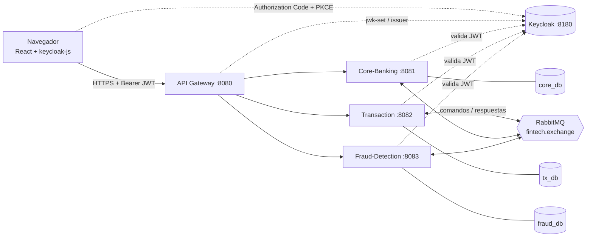

# 02 — TRD: Requisitos técnicos

> Fuente original: [plan-proyecto.md](plan-proyecto.md). Ante diferencias, prevalecen los documentos 01 a 07.
> **⚠️ SUPUESTO** = decisión tomada donde el plan no definía nada o lo corrige.

## 1. Stack completo

Versiones verificadas en octubre de 2026 contra los sitios oficiales. **Antes de generar cada proyecto en start.spring.io, confirmar que siguen siendo las últimas estables** (⚠️ SUPUESTO: se fija la línea mayor/menor, el parche lo da el generador).

> **⚠️ SUPUESTO — compatibilidad Spring Boot ↔ Spring Cloud.** Antes de la Fase 1 (al generar el primer proyecto) hay que verificar en la tabla oficial de compatibilidad de Spring Cloud (spring.io/projects/spring-cloud, columna "Supported Spring Boot") que la versión de Spring Boot elegida está soportada por el release train de Spring Cloud elegido. Si no coinciden, se usa la versión de Spring Boot que soporte Spring Cloud (no al revés), y se actualiza esta tabla. Aplica a los cuatro proyectos Java por igual.

| Capa | Tecnología | Versión | Notas |
| --- | --- | --- | --- |
| Lenguaje | Java (Temurin) | **21 LTS** | Records, virtual threads. ⚠️ SUPUESTO: se mantiene 21 aunque haya LTS más nuevos; Boot 4 lo soporta |
| Framework | Spring Boot | **4.1.x** | Web MVC, Data JPA, Validation, Actuator. (El plan decía 3.x: la 3.5 ya está fuera de soporte OSS) |
| Cloud | Spring Cloud | **2025.1.x (Oakwood)** | Compatible con Boot 4.x. Gateway reactivo (starter de Gateway Server WebFlux; ⚠️ verificar el nombre exacto del starter al generar) |
| Seguridad | Spring Security OAuth2 Resource Server | la de Boot | JWT en cada servicio y en el gateway |
| Identidad | Keycloak | **26.x** (≥ 26.7) | Imagen `quay.io/keycloak/keycloak`; realm importado al arrancar |
| Mensajería | RabbitMQ + Spring AMQP | **4.x** (`rabbitmq:4-management`) | Exchange topic, DLQ, publisher confirms |
| Base de datos | PostgreSQL | **17** (`postgres:17`) | ⚠️ SUPUESTO: 17 por madurez; una instancia, 3 bases |
| Migraciones | Flyway | la de Boot | `db/migration/V1__...sql` |
| Boilerplate | Lombok | la de Boot | Sin MapStruct (⚠️ SUPUESTO): se mapea con records y métodos `from(...)` |
| Rate limit | Bucket4j | última estable | En memoria en el gateway, sin Redis (⚠️ SUPUESTO) |
| Tests backend | JUnit 5, Mockito, AssertJ, Awaitility, Testcontainers (Postgres, RabbitMQ), `spring-security-test` | las de Boot | Un test e2e con Keycloak real |
| Docs API | springdoc-openapi | última compatible con Boot 4 | Swagger UI solo en perfil `dev` |
| Frontend | React 19 + TypeScript + Vite + Tailwind CSS + TanStack Query + React Router | últimas estables | Node 22 LTS |
| Login front | `keycloak-js` | última | Authorization Code + PKCE (S256). ⚠️ SUPUESTO: se elige `keycloak-js` |
| Tests front | Vitest + Testing Library + Playwright (e2e) | últimas | |
| Infra | Docker Desktop (WSL 2) + Docker Compose v2 | | Dev en Windows |
| Proxy/HTTPS | Caddy 2 | | Solo en el VPS |
| Observabilidad (opcional) | Micrometer Tracing + Zipkin | | Al final |

## 2. Servicios externos

| Servicio | Uso | Puerto host (por defecto) | Dónde corre |
| --- | --- | --- | --- |
| Keycloak | Login, JWT, roles, registro | **8180** | Contenedor |
| RabbitMQ | Comandos y eventos de la Saga | 5672 (AMQP) / 15672 (UI) | Contenedor |
| PostgreSQL | `core_db`, `tx_db`, `fraud_db` | 5432 | Contenedor (una instancia) |
| API Gateway | Entrada única | **8080** | Contenedor |
| Core / Transaction / Fraud | Servicios | 8081 / 8082 / 8083 | Contenedores |
| Frontend (dev) | Vite | 5173 | Local con `npm run dev` |
| VPS | Oracle Cloud free tier (ARM64, ≥ 4 GB) | 80/443 | Producción |
| Caddy | HTTPS automático | 80/443 | VPS |
| DNS | `sslip.io` o DuckDNS (⚠️ SUPUESTO) | | `app.<IP>.sslip.io` y `auth.<IP>.sslip.io` |

Todos los puertos de host son configurables por `.env` para evitar choques en Windows.

## 3. Arquitectura general



Reglas de la arquitectura:
- Los servicios **no se llaman entre sí por HTTP** para mover dinero; solo RabbitMQ.
- Cada servicio es dueño exclusivo de su base y de su usuario de base.
- El front solo habla con el gateway (y con Keycloak para el login).
- Cada servicio vuelve a validar el JWT (el gateway no es un perímetro de confianza).

## 4. Decisiones de arquitectura

### 4.1 Saga orquestada vs coreografía
- **Elegido:** orquestada. Transaction-Service decide el siguiente paso según cada respuesta.
- **Alternativa:** coreografía (cada servicio reacciona a eventos de otros).
- **Por qué:** toda la lógica y la máquina de estados viven en un lugar, lo que facilita razonar compensaciones, timeouts y reintentos, testear transiciones y explicarlo en una entrevista. Costo: Transaction es un punto de coordinación (aceptable con 3 servicios).

### 4.2 Outbox transaccional
- **Elegido:** tabla `outbox_events` en la misma transacción que el cambio de estado; un publicador `@Scheduled` (cada 1 s) envía y marca `SENT` solo tras el *publisher confirm*.
- **Alternativas:** publicar directo con `rabbitTemplate.send()` (puede perder el mensaje o enviarlo sin commit); CDC con Debezium (sobredimensionado).
- **Por qué:** garantiza que estado y mensaje son atómicos. La entrega es *at-least-once*, por eso todo consumidor es idempotente. Se lee con `FOR UPDATE SKIP LOCKED` (seguro con varias instancias).
- Regla de código: **nunca** llamar a `rabbitTemplate` desde la lógica de negocio; solo desde el publicador del outbox.

### 4.3 Idempotencia por clave de negocio (corrige el plan) ⚠️ SUPUESTO
- **Elegido:** Core-Banking guarda `transfer_operations` con `UNIQUE(transfer_id, step)` (DEBIT / CREDIT / REFUND) y el **mensaje de respuesta original**. Un comando repetido (aunque llegue con otro `messageId`) no vuelve a ejecutar: **re-emite la respuesta guardada** por su outbox y recién entonces hace ack.
- **Alternativa del plan:** solo `processed_messages(messageId)`.
- **Por qué:** el reenvío por timeout genera un `messageId` nuevo, así que deduplicar por `messageId` no alcanza; y descartar en silencio un duplicado deja al orquestador esperando una respuesta perdida. `processed_messages` se mantiene como deduplicación técnica adicional (mismo `messageId` redelivered) y en Transaction/Fraud para replies/eventos.
- **API:** `Idempotency-Key` con `UNIQUE(user_id, idempotency_key)` + hash SHA-256 del payload; misma clave con distinto payload → 422.

### 4.4 Bloqueo pesimista + optimista
- **Elegido:** `@Lock(PESSIMISTIC_WRITE)` (`SELECT ... FOR UPDATE`) al tocar el saldo, y `@Version` como red de seguridad. `READ COMMITTED` (por defecto). `CHECK` en base como última defensa.
- **Alternativas:** solo optimista (reintentos bajo contención), `SERIALIZABLE` en todo (más reintentos y complejidad).
- **Por qué:** en dinero, la contención sobre la misma cuenta es el caso a proteger; serializar con lock es simple y predecible.
- **Nota sobre deadlocks:** cada paso de la Saga toca **una sola cuenta** por transacción, por lo que no hay deadlock entre cuentas; el plan original proponía ordenar por id, innecesario aquí.
- **Constraint:** `CHECK (type = 'SYSTEM' OR balance >= 0)`; solo las cuentas `USER` no pueden ser negativas (TREASURY puede serlo).

### 4.5 Ledger de doble entrada con cuenta TREASURY ⚠️ SUPUESTO
- **Elegido:** existe una cuenta de sistema `TREASURY` (`accounts.type = 'SYSTEM'`). Un depósito **debita TREASURY y acredita al usuario** con dos asientos de importes opuestos. Los asientos usan importes con signo (`amount` negativo = sale dinero).
- **Por qué:** sin contrapartida, un depósito crea dinero de la nada y la invariante contable no puede verificarse. Con TREASURY, el sistema completo suma cero.
- Cuenta sembrada con id fijo `00000000-0000-0000-0000-000000000001` y alias `treasury`.

### 4.6 Una base por servicio
- **Elegido:** 3 bases (`core_db`, `tx_db`, `fraud_db`) en **una** instancia Postgres con 3 usuarios, cada uno con permisos solo sobre la suya (`REVOKE CONNECT ... FROM PUBLIC`).
- **Alternativas:** una base compartida (acopla servicios); 3 contenedores (más RAM).
- **Por qué:** aislamiento real de datos con el menor consumo de memoria.

### 4.7 Keycloak vs Spring Authorization Server
- **Elegido:** Keycloak.
- **Alternativa:** Spring Authorization Server (más control, mucho más código de infraestructura).
- **Por qué:** Keycloak da registro, login, roles, refresh y consola sin escribir un servidor de identidad; el valor del proyecto está en la Saga y el dinero, no en reinventar OAuth2. Se usa un único cliente público `wallet-frontend` (sin cliente `gateway`: el gateway solo valida tokens, ⚠️ SUPUESTO).

### 4.8 RabbitMQ vs Kafka
- **Elegido:** RabbitMQ.
- **Alternativa:** Kafka.
- **Por qué:** el patrón es comando/respuesta con colas por servicio, DLQ y ack individual — modelo natural de RabbitMQ. Kafka (log, particiones, retención) agrega operación y memoria sin beneficio para este volumen.

### 4.9 Gateway reactivo y rate limiting sin Redis ⚠️ SUPUESTO
- Spring Cloud Gateway reactivo (WebFlux) valida JWT, aplica CORS (solo el origen del front), cabeceras de seguridad y rate limit por usuario en `POST /api/transfers` y depósitos con **Bucket4j en memoria** (el `RequestRateLimiter` nativo exige Redis). Límite inicial: 10 solicitudes/min por `sub` en `POST /api/transfers`.

### 4.10 Topología RabbitMQ declarada por código ⚠️ SUPUESTO
- Exchange, colas, bindings y DLQ se declaran con `@Bean` (`Declarables`) en cada servicio (idempotente, funciona en Testcontainers sin cargar `definitions.json`). El plan sugería `infra/rabbitmq/definitions.json`; se descarta.
- **Regla:** cada cola y su DLQ las declara únicamente el servicio que la consume; los exchanges (`fintech.exchange`, `fintech.dlx`) los declaran todos con los mismos argumentos. Detalle en [05 §6.1](05-esquema-backend.md#61-topología-declarada-por-bean-en-cada-servicio--supuesto).

### 4.11 Cifrado en reposo acotado
- AES-256-GCM sólo para `accounts.account_number` (CBU simulado) mediante `AttributeConverter` JPA. Clave de 32 bytes en base64 en `APP_CRYPTO_KEY`. Formato almacenado: `base64(iv[12] || ciphertext || tag)`. No se cifra "documento" (nadie lo recolecta). Como el campo cifrado no es buscable, el destino se resuelve por alias.

## 5. Invariante de conciliación

Única fórmula, usada igual en [05-esquema-backend](05-esquema-backend.md) y [07-criterios-aceptacion](07-criterios-aceptacion.md):

> **suma(saldos de todas las cuentas, incluida TREASURY) + montos debitados todavía no acreditados ni revertidos = 0**

- "Debitados todavía no acreditados ni revertidos" = transferencias con operación `DEBIT` exitosa en `transfer_operations` y sin `CREDIT` exitoso ni `REFUND` exitoso.
- Además se verifica por cuenta: `balance = suma(ledger_entries.amount)`.
- Los depósitos no rompen la invariante porque debitan TREASURY.

## 6. Requisitos no funcionales

### Seguridad
- JWT validado en gateway **y** en cada servicio (firma, `exp`, `iss`). Access token ≈ 5 min. Autorización por rol (`@PreAuthorize`) y **propiedad** (`sub` = `user_id` del recurso); recurso ajeno → **404**.
- Sin secretos en el código ni en el repositorio: `.env` local (en `.gitignore`), variables de entorno en el VPS.
- Logs sin tokens ni claves; números de cuenta enmascarados (`****1234`). Respuestas de error uniformes sin trazas.
- HTTPS en producción (Caddy). CORS restringido. Cabeceras: `X-Content-Type-Options`, `Referrer-Policy`, `Content-Security-Policy` (front), HSTS (Caddy).
- Usuario de base con permisos mínimos, solo sobre su base.

### Consistencia
- Dinero: `BigDecimal` + `NUMERIC(19,4)`. Prohibido `double`/`float`.
- Cada transición de estado y su mensaje de salida se guardan en **una** transacción (Outbox).
- Ack manual **después** del commit. Publisher confirms activados. Reintentos del consumidor: 3 y luego DLQ.
- La Saga es determinista: un reply que no corresponde al estado actual se ignora (ack + log).
- Cada paso posterior al débito termina en `COMPLETED` o `COMPENSATED`; nunca se abandona automáticamente (si se agotan los reintentos pasa a `FAILED_MANUAL_REVIEW` y un ADMIN lo reanuda).

### Idempotencia
- API (`Idempotency-Key` en transferencias y depósitos), comandos de Core (`transfer_operations`), replies de Transaction (estado + `saga_steps`), eventos de Fraud (`UNIQUE(transfer_id)`).

### Observabilidad
- Actuator `health`/`info`/`metrics` (health público solo en red interna).
- Logs JSON con `transferId`, `messageId` y `userId` en MDC; correlación entre servicios por `transferId`.
- Métricas Micrometer: transferencias por estado, outbox pendiente, mensajes en DLQ.
- Opcional: trazas con Zipkin.

### Rendimiento y recursos
- 4 JVM + Keycloak + RabbitMQ + Postgres en ≤ 4 GB en el VPS: `JAVA_TOOL_OPTIONS=-Xmx256m` por servicio y `mem_limit` en Compose.

## 7. Entorno Windows + Docker Desktop

| Riesgo | Mitigación |
| --- | --- |
| WSL 2 consume hasta el 50 % de RAM | `%UserProfile%\.wslconfig`: `[wsl2]` `memory=6GB` `processors=4`; reiniciar con `wsl --shutdown` |
| Saltos de línea CRLF rompen scripts/SQL en contenedores Linux | `.gitattributes`: `* text=auto eol=lf` y `*.cmd text eol=crlf` |
| `mvnw` pierde el bit ejecutable | `git update-index --chmod=+x <servicio>/mvnw` o `RUN sh mvnw ...` en el Dockerfile |
| Bind mounts de `C:\` lentos y con permisos | Volúmenes nombrados para Postgres/RabbitMQ/Keycloak |
| `init.sql` y `--import-realm` solo corren con volumen vacío | Documentar `docker compose down -v` para reaplicar |
| Puertos ocupados (5432, 8080, 5672) | Puertos de host en `.env` |
| `iss` del JWT no coincide dentro/fuera de Docker | Host único **`keycloak`**: `Add-Content C:\Windows\System32\drivers\etc\hosts "127.0.0.1 keycloak"` (PowerShell como administrador); Keycloak escucha en 8180 en todos lados y `KC_HOSTNAME=http://keycloak:8180`. En producción: `KC_HOSTNAME=https://auth.<IP>.sslip.io`, `KC_PROXY_HEADERS=xforwarded`, y los servicios usan `jwk-set-uri` interno + `issuer-uri` público |
| Keycloak tarda 30–60 s | `healthcheck` + `depends_on: condition: service_healthy` |
| Testcontainers necesita Docker encendido | Verificar `docker info` antes de `verify`; CI en Ubuntu |
| Imágenes ARM en Oracle | Usar imágenes multi-arch (`eclipse-temurin:21-jre`, `postgres`, `rabbitmq`, `keycloak`) |

## 8. Estructura del monorepo

Un proyecto Maven independiente por servicio (sin POM padre, como en el plan). Paquetes por funcionalidad.

```
fintech-wallet/
├── CLAUDE.md
├── README.md
├── .env.example
├── .gitignore
├── .gitattributes
├── docker-compose.yml               # Postgres, RabbitMQ, Keycloak, servicios, frontend
├── docker-compose.prod.yml          # override del VPS: Caddy, límites de memoria
├── .github/workflows/ci.yml
├── docs/                            # 01..07 + plan-proyecto.md
├── infra/
│   ├── keycloak/realm-fintech.json
│   ├── postgres/init.sql            # 3 bases, 3 usuarios
│   └── caddy/Caddyfile
├── api-gateway/                     # com.agustin.gateway.{security,routing,ratelimit,config}
├── core-banking-service/            # com.agustin.corebanking
│   ├── pom.xml  Dockerfile  mvnw  mvnw.cmd
│   └── src/main/java/com/agustin/corebanking/
│       ├── account/                 # entity, repository, service, controller, dto
│       ├── ledger/
│       ├── deposit/
│       ├── operation/               # transfer_operations (idempotencia de pasos)
│       ├── reconciliation/
│       ├── audit/
│       ├── messaging/               # listeners de comandos
│       ├── outbox/                  # entidad + publicador @Scheduled
│       ├── security/                # SecurityConfig, converter de roles
│       ├── crypto/                  # AttributeConverter AES-GCM
│       └── common/                  # excepciones, handler global, config
│   └── src/main/resources/{application.yml, db/migration/V1__init.sql, ...}
├── transaction-service/             # com.agustin.transaction
│   └── ...                          # transfer/, saga/, messaging/, outbox/, security/, admin/, common/
├── fraud-detection-service/         # com.agustin.fraud
│   └── ...                          # assessment/, rules/, messaging/, outbox/, security/, common/
└── wallet-frontend/                 # React + TS + Vite + Tailwind
    └── src/{auth,api,features/{account,transfer,history,admin},components,routes,styles}
```

No existe `shared-events` (⚠️ SUPUESTO): los *records* de mensajes se duplican en cada servicio y el contrato vive en [05-esquema-backend](05-esquema-backend.md#6-rabbitmq).
