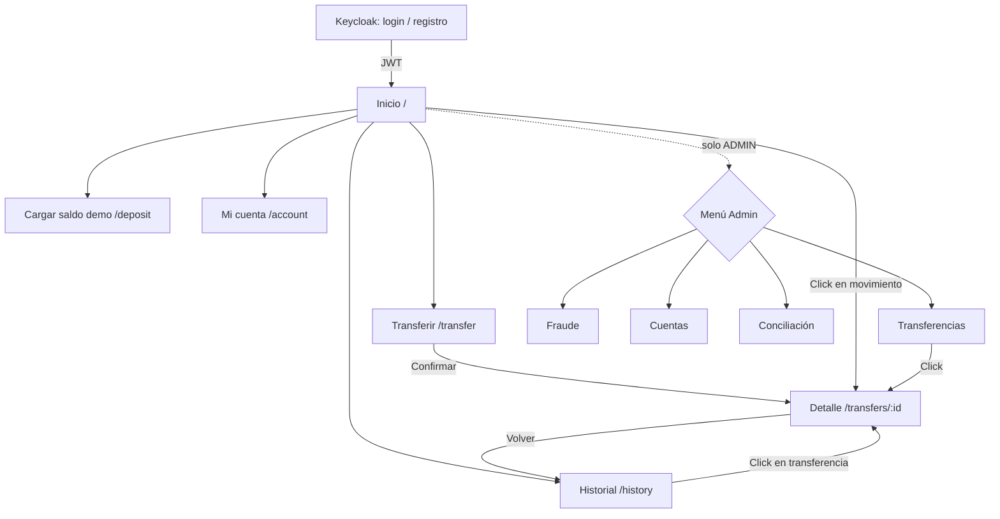
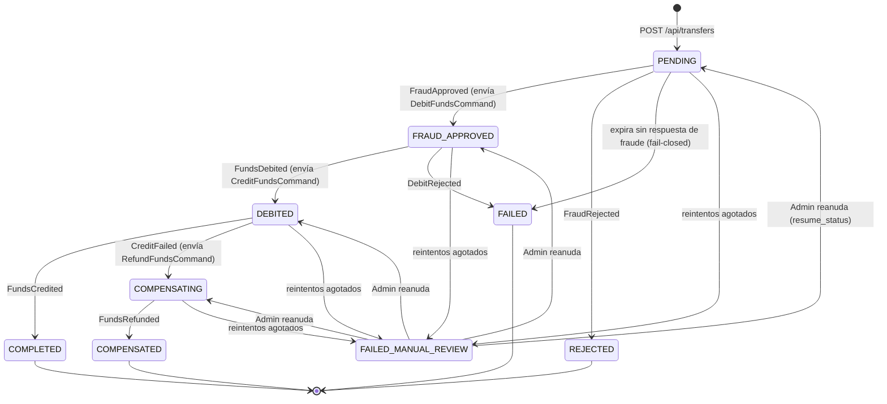
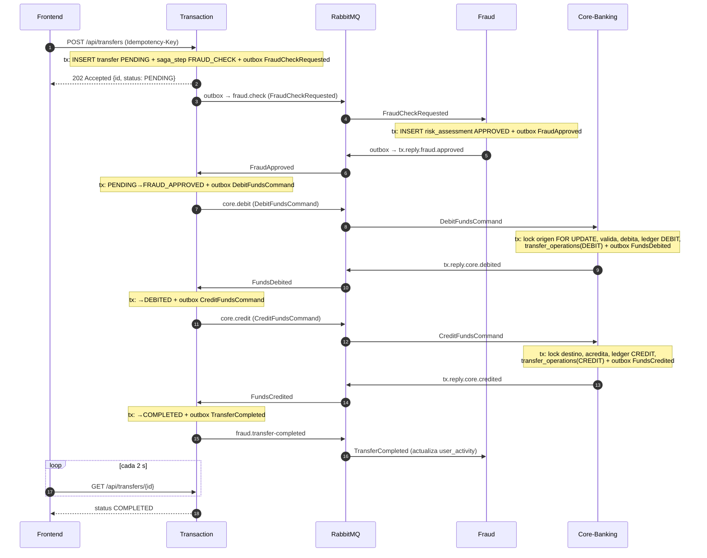
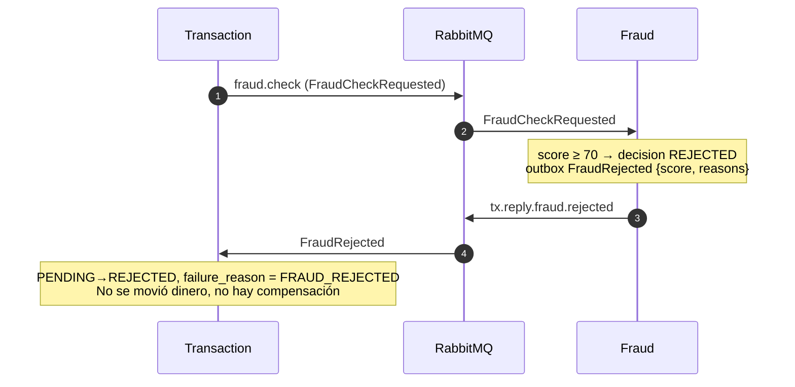
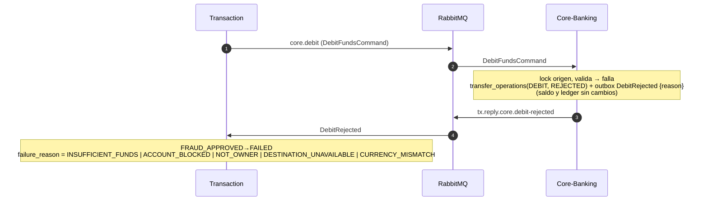

# 03 — Flujo de la app y de la Saga

> Fuente original: [plan-proyecto.md](plan-proyecto.md). Ante diferencias, prevalecen los documentos 01 a 07.
> UI en español; nombres de rutas, estados y campos en inglés. **⚠️ SUPUESTO** = decisión propia.

## 1. Pantallas

| # | Pantalla | Ruta | Rol | Contenido |
| --- | --- | --- | --- | --- |
| 1 | Login / Registro | (Keycloak) | público | Pantalla de Keycloak con registro habilitado |
| 2 | Inicio | `/` | USER | Tarjeta de saldo, alias y CBU enmascarado, acciones rápidas, últimos 5 movimientos |
| 3 | Transferir | `/transfer` | USER | Alias destino (con verificación), monto, descripción, resumen y confirmación |
| 4 | Detalle de transferencia | `/transfers/:id` | USER | Estado en vivo (línea de pasos), motivo si falló, monto, fecha |
| 5 | Historial | `/history` | USER | Movimientos del ledger paginados + pestaña "Transferencias" con filtro por estado (incluye rechazadas) |
| 6 | Cargar saldo demo | `/deposit` | USER | Monto (máx. 50.000), saldo máximo 200.000 |
| 7 | Mi cuenta | `/account` | USER | Alias (edición única), CBU enmascarado/visible, estado |
| 8 | Admin · Transferencias | `/admin/transfers` | ADMIN | Todas las transferencias, filtro por estado, acción "Reanudar" |
| 9 | Admin · Fraude | `/admin/fraud` | ADMIN | Evaluaciones (filtro) y reglas (activar, peso, umbral) |
| 10 | Admin · Cuentas | `/admin/accounts` | ADMIN | Lista, bloquear/desbloquear, depósito libre |
| 11 | Admin · Conciliación | `/admin/reconciliation` | ADMIN | Ejecutar y ver resultado de la invariante |
| 12 | 404 / Sin permiso | `*` | todos | Mensaje genérico |

## 2. Navegación



## 3. Recorridos principales

### 3.1 Usuario nuevo
1. Entra a la app → no hay sesión → redirección a Keycloak → "Registrarse" (usuario, email, contraseña) → vuelve con código → `keycloak-js` obtiene el JWT (PKCE).
2. El front llama `GET /api/accounts/me`. Si responde 404 `ACCOUNT_NOT_FOUND`, llama `POST /api/accounts` (idempotente) y muestra "Creando tu cuenta…".
3. Inicio muestra saldo `$ 0,00` y un aviso "Cargá saldo demo para probar".
4. En `/deposit` carga 50.000 → saldo actualizado.
5. En `/transfer` ingresa el alias de otro usuario → verificación → monto → confirmar → detalle en vivo → `COMPLETED`.

### 3.2 Transferencia exitosa
Inicio → Transferir → alias válido → monto → "Revisar" → "Confirmar" → Detalle con pasos: *Verificando seguridad → Debitando → Acreditando → Completada*. Al terminar, el saldo de Inicio se invalida y refresca.

### 3.3 Rechazada por fraude
Monto > 100.000 → el detalle muestra estado `REJECTED` con el mensaje "Tu transferencia fue rechazada por nuestras reglas de seguridad. No se movió dinero." y los motivos legibles (ej. "Monto superior al límite por operación"). Aparece en Historial → Transferencias con el filtro "Rechazadas".

### 3.4 Sin fondos / destino no disponible
Estado `FAILED` con motivo "Saldo insuficiente" o "La cuenta destino no está disponible". No se movió dinero.

### 3.5 Crédito fallido con compensación
Estado pasa por `DEBITED → COMPENSATING → COMPENSATED`; el detalle dice "No pudimos acreditar al destinatario. Te devolvimos el dinero." y en el historial se ve el débito y el asiento de reversa.

### 3.6 ADMIN
Menú Admin → Transferencias (filtro `FAILED_MANUAL_REVIEW` → "Reanudar"), Fraude (apagar/ajustar reglas), Cuentas (bloquear/desbloquear, depositar), Conciliación (ejecutar y ver `ok`).

## 4. Acciones importantes: qué pasa, errores y carga

Convenciones de UI: todo botón que dispara una petición se deshabilita y muestra *spinner* mientras espera; los errores se muestran en un *toast* + mensaje en el formulario; errores de red muestran "No pudimos conectar. Reintentá." con botón de reintento. Todos los textos van en español.

| Acción | Petición | Estados de carga | Errores y mensajes |
| --- | --- | --- | --- |
| Primer login | `GET /api/accounts/me` → (404) `POST /api/accounts` | Skeleton de la tarjeta | 401 → relogin automático; 5xx → "No pudimos cargar tu cuenta" + reintentar |
| Verificar alias | `GET /api/accounts/lookup?alias=` (debounce 400 ms) | Spinner en el input | 404 → "No encontramos ese alias"; si es el propio → "No podés transferirte a vos mismo" |
| Confirmar transferencia | `POST /api/transfers` con `Idempotency-Key` generada con `crypto.randomUUID()` **al abrir el formulario** (se reutiliza en reintentos/doble click, se renueva solo tras éxito) | Botón "Enviando…" bloqueado | 400/422 → error por campo (`INVALID_AMOUNT` "Monto inválido", `AMOUNT_LIMIT_EXCEEDED` "El máximo por operación es $ 1.000.000", `SAME_ACCOUNT`, `IDEMPOTENCY_KEY_REUSED`); 429 → "Demasiados intentos, esperá un minuto"; 202/200 → navegar a `/transfers/:id` |
| Ver estado | `GET /api/transfers/{id}` con polling cada 2 s (TanStack Query `refetchInterval`) hasta estado terminal, luego el polling se detiene | Indicador de pasos animado | 404 → "No encontramos la transferencia"; si pasan 60 s sin estado terminal → "Sigue en proceso, podés salir; te lo mostramos en el historial" (el polling se detiene) |
| Cargar saldo demo | `POST /api/accounts/me/demo-deposit` + `Idempotency-Key` | Botón bloqueado | `DEMO_LIMIT_EXCEEDED` (máx. 50.000), `BALANCE_CAP_EXCEEDED` (máx. 200.000), 429 |
| Historial | `GET /api/accounts/{id}/movements?page&size=20` y `GET /api/transfers?status=` | Skeletons de filas | Vacío → "Todavía no hay movimientos" |
| Cambiar alias (una vez) | `PATCH /api/accounts/me/alias` | Botón bloqueado | `ALIAS_TAKEN`, `ALIAS_ALREADY_CHANGED`, `ALIAS_INVALID` |
| Bloquear/desbloquear cuenta (ADMIN) | `PATCH /api/accounts/{id}/status` | Confirmación modal + spinner | 404, 403 |
| Reglas de fraude (ADMIN) | `PATCH /api/fraud/rules/{code}` | Switch optimista con rollback | 422 si valores inválidos |
| Reanudar transferencia (ADMIN) | `POST /api/admin/transfers/{id}/resume` | Spinner | 409 si no está en `FAILED_MANUAL_REVIEW` |
| Conciliación (ADMIN) | `GET /api/admin/reconciliation` | Spinner | `ok=false` → tabla de discrepancias |

Comportamiento global ante `401`: el cliente intenta `updateToken(30)`; si falla, redirige al login conservando la ruta. Ante `403`: pantalla "Sin permiso". Los recursos ajenos devuelven `404` (nunca `403`).

## 5. Máquina de estados de la transferencia



Notas (⚠️ SUPUESTO, refinan el plan):
- **`PENDING` expira a `FAILED`** (`failure_reason = SAGA_TIMEOUT`) tras 5 minutos sin respuesta de fraude: no se movió plata. Un `FraudApproved` tardío se ignora porque el estado ya es terminal.
- **`FRAUD_APPROVED` no expira a `FAILED`**: el débito pudo haberse aplicado con la respuesta perdida. Se reintenta el `DebitFundsCommand` hasta obtener respuesta (idempotente); si se agotan los reintentos pasa a `FAILED_MANUAL_REVIEW`.
- Los pasos `DEBITED` y `COMPENSATING` nunca se abandonan solos.
- Reply que no corresponde al estado actual (duplicado o tardío): ack + log, sin cambiar nada.
- Estados terminales: `COMPLETED`, `REJECTED`, `FAILED`, `COMPENSATED`.
- `FAILED_MANUAL_REVIEW` no es terminal: guarda `resume_status` para poder reanudar.

Reintentos del orquestador (job `@Scheduled` cada 30 s sobre `transfers` no terminales): reenvía el último comando con backoff 30 s, 60 s, 120 s, 240 s y 480 s (5 intentos); luego `FAILED_MANUAL_REVIEW`.

## 6. Flujos de la Saga (secuencia)

Participantes: `FE` frontend, `TX` Transaction (orquestador, con su outbox), `MQ` RabbitMQ, `FR` Fraud, `CORE` Core-Banking (con su outbox). Cada mensaje sale de un `outbox_events` y se publica con publisher confirm; los consumidores hacen ack **después** del commit. Las peticiones del front pasan por el gateway.

### 6.1 Caso feliz



### 6.2 Fraude rechazado



### 6.3 Débito rechazado (sin fondos, cuenta bloqueada, dueño inválido, destino no disponible)



### 6.4 Crédito fallido con compensación

```mermaid
sequenceDiagram
    autonumber
    participant TX as Transaction
    participant MQ as RabbitMQ
    participant CORE as Core-Banking
    Note over TX,CORE: ya se aplicó el DEBIT (estado DEBITED)
    TX->>MQ: core.credit (CreditFundsCommand)
    MQ->>CORE: CreditFundsCommand
    Note over CORE: destino BLOCKED o inexistente<br/>transfer_operations(CREDIT, REJECTED) + outbox CreditFailed {reason}
    CORE->>MQ: tx.reply.core.credit-failed
    MQ->>TX: CreditFailed
    Note over TX: DEBITED→COMPENSATING + outbox RefundFundsCommand
    TX->>MQ: core.refund (RefundFundsCommand)
    MQ->>CORE: RefundFundsCommand
    Note over CORE: exige CREDIT=REJECTED; lock origen (ignora BLOCKED)<br/>acredita monto, ledger REVERSAL<br/>transfer_operations(REFUND) + outbox FundsRefunded
    CORE->>MQ: tx.reply.core.refunded
    MQ->>TX: FundsRefunded
    Note over TX: COMPENSATING→COMPENSATED<br/>saldo del origen restituido
```

### 6.5 Timeout / respuesta perdida / duplicado

```mermaid
sequenceDiagram
    autonumber
    participant TX as Transaction
    participant MQ as RabbitMQ
    participant CORE as Core-Banking
    TX->>MQ: core.debit (messageId = A)
    MQ->>CORE: DebitFundsCommand (A)
    Note over CORE: aplica el débito, guarda transfer_operations(DEBIT) con la respuesta
    CORE--xMQ: FundsDebited se pierde (broker/servicio caído)
    Note over TX: Job @Scheduled (cada 30 s): transfer en FRAUD_APPROVED sin respuesta
    TX->>MQ: core.debit (messageId = B, nuevo outbox)
    MQ->>CORE: DebitFundsCommand (B)
    Note over CORE: UNIQUE(transfer_id, step) ya existe →<br/>NO vuelve a debitar; re-emite FundsDebited desde la respuesta guardada
    CORE->>MQ: tx.reply.core.debited
    MQ->>TX: FundsDebited
    Note over TX: FRAUD_APPROVED→DEBITED y sigue el flujo.<br/>Si llega un segundo FundsDebited: estado ya avanzó → ack + log
    Note over TX: Tras 5 reintentos sin respuesta →<br/>FAILED_MANUAL_REVIEW (alerta ADMIN, reanudable)
```

### 6.6 RabbitMQ caído a mitad de la Saga
- Mientras el broker está caído, los eventos quedan en `outbox_events` con `status = PENDING`; el publicador reintenta cada segundo (el publisher confirm no llega, `attempts++`).
- Al volver el broker, se publican y la Saga continúa sin intervención. Criterio de la Fase 3: apagar y prender RabbitMQ durante una transferencia y verla terminar.
