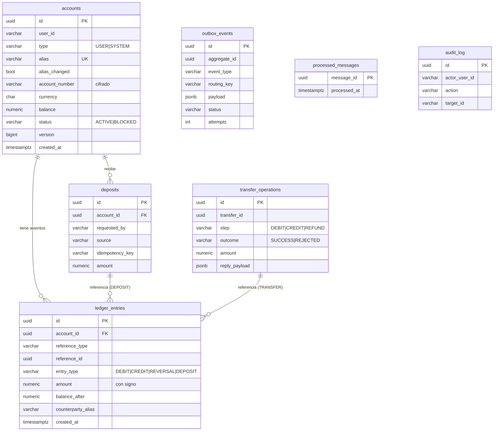
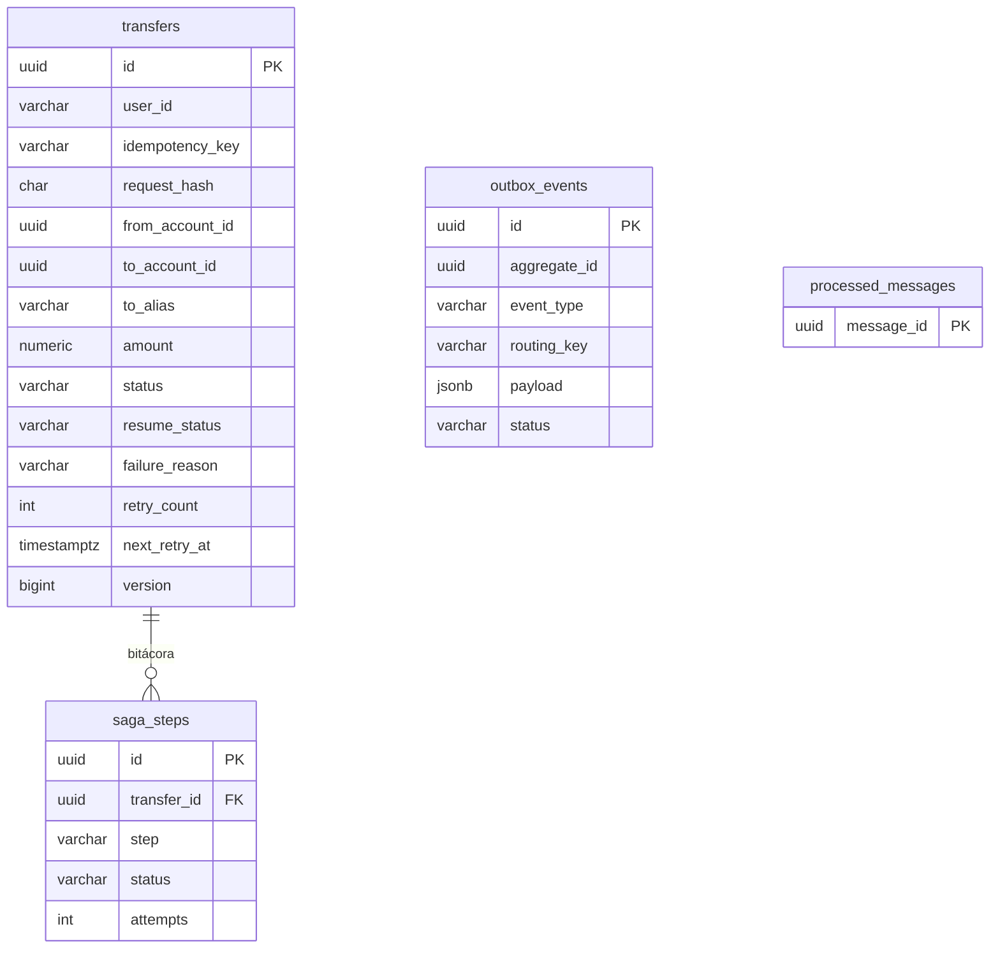
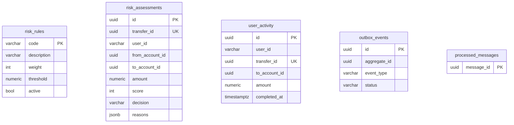
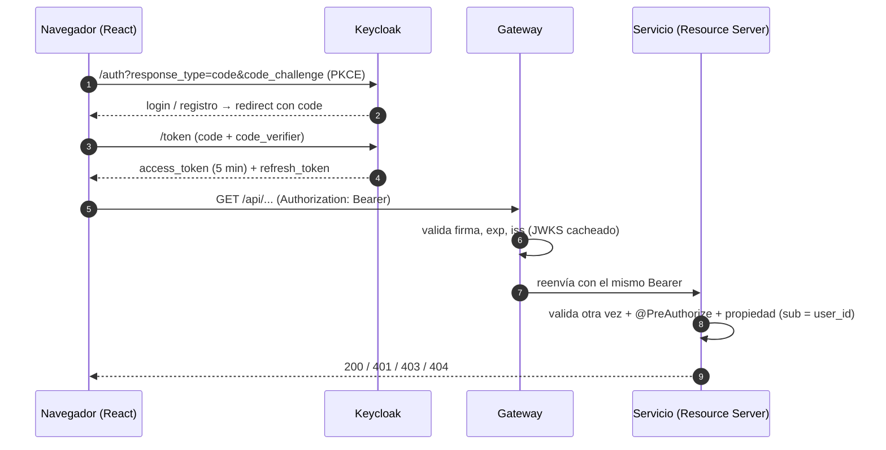

# 05 — Esquema del backend

> Fuente original: [plan-proyecto.md](plan-proyecto.md). Ante diferencias, prevalecen los documentos 01 a 07.
> **⚠️ SUPUESTO** = decisión propia. Convenciones: ids `UUID`; fechas `TIMESTAMPTZ` en UTC (ISO-8601 en JSON); montos `NUMERIC(19,4)` en base y **string decimal** en JSON (`"1500.00"`, nunca número); dinero siempre `BigDecimal`; paquetes `com.agustin.corebanking`, `com.agustin.transaction`, `com.agustin.fraud`, `com.agustin.gateway`.
> Todas las tablas se crean con Flyway (`V1__init.sql`, ...). Cada servicio usa su propio usuario de base (`core_user`, `tx_user`, `fraud_user`) con permisos solo sobre su base.

## 1. Core-Banking-Service (`core_db`, puerto 8081)

### 1.1 Tablas

#### `accounts`
| Columna | Tipo | Restricciones |
| --- | --- | --- |
| `id` | UUID | PK |
| `user_id` | VARCHAR(64) | `sub` del JWT; NULL solo si `type = 'SYSTEM'` |
| `type` | VARCHAR(10) | NOT NULL, `CHECK (type IN ('USER','SYSTEM'))` |
| `alias` | VARCHAR(30) | NOT NULL, UNIQUE (minúsculas, `[a-z0-9._-]{3,30}`) |
| `alias_changed` | BOOLEAN | NOT NULL DEFAULT false (el alias se edita una sola vez) |
| `account_number` | VARCHAR(255) | NOT NULL; **cifrado AES-256-GCM** (CBU simulado de 22 dígitos) |
| `currency` | CHAR(3) | NOT NULL DEFAULT 'ARS', `CHECK (currency = 'ARS')` |
| `balance` | NUMERIC(19,4) | NOT NULL DEFAULT 0 |
| `status` | VARCHAR(10) | NOT NULL DEFAULT 'ACTIVE', `CHECK (status IN ('ACTIVE','BLOCKED'))` |
| `version` | BIGINT | NOT NULL DEFAULT 0 (`@Version`) |
| `created_at` | TIMESTAMPTZ | NOT NULL DEFAULT now() |

Restricciones adicionales:
- `CHECK (type = 'SYSTEM' OR balance >= 0)` — solo las cuentas `USER` no pueden ser negativas; TREASURY sí.
- `CHECK (type = 'SYSTEM' OR user_id IS NOT NULL)`.
- Índice único parcial: `UNIQUE (user_id) WHERE type = 'USER'` (una cuenta por usuario).
- Dato sembrado en `V1`: `TREASURY` → `id = 00000000-0000-0000-0000-000000000001`, `type = SYSTEM`, `alias = 'treasury'`, `user_id = NULL`, `balance = 0`.

#### `ledger_entries`
Importes con signo: negativo = sale dinero de la cuenta; positivo = entra. El saldo de una cuenta es la suma de sus asientos.

| Columna | Tipo | Restricciones |
| --- | --- | --- |
| `id` | UUID | PK |
| `account_id` | UUID | NOT NULL, FK → `accounts(id)` |
| `reference_type` | VARCHAR(10) | NOT NULL, `CHECK IN ('TRANSFER','DEPOSIT')` |
| `reference_id` | UUID | NOT NULL (`transfer_id` o `deposits.id`) |
| `entry_type` | VARCHAR(10) | NOT NULL, `CHECK IN ('DEBIT','CREDIT','REVERSAL','DEPOSIT')` |
| `amount` | NUMERIC(19,4) | NOT NULL, `CHECK (amount <> 0)` |
| `balance_after` | NUMERIC(19,4) | NOT NULL |
| `counterparty_alias` | VARCHAR(30) | NULL (alias de la otra parte, instantánea para mostrar) |
| `created_at` | TIMESTAMPTZ | NOT NULL DEFAULT now() |

Restricciones:
- `UNIQUE (account_id, reference_id, entry_type)` — el mismo movimiento no se aplica dos veces.
- `CHECK ((entry_type = 'DEBIT' AND amount < 0) OR (entry_type IN ('CREDIT','REVERSAL') AND amount > 0) OR entry_type = 'DEPOSIT')`. En un depósito, el asiento del usuario es positivo y el de TREASURY negativo.
- Índice `(account_id, created_at DESC)` para el historial.
- Los asientos son inmutables: nunca `UPDATE`/`DELETE` (se puede reforzar con un trigger o permisos).

#### `transfer_operations` (idempotencia de pasos y respuesta guardada) ⚠️ SUPUESTO
| Columna | Tipo | Restricciones |
| --- | --- | --- |
| `id` | UUID | PK |
| `transfer_id` | UUID | NOT NULL |
| `step` | VARCHAR(10) | NOT NULL, `CHECK IN ('DEBIT','CREDIT','REFUND')` |
| `outcome` | VARCHAR(10) | NOT NULL, `CHECK IN ('SUCCESS','REJECTED')` |
| `amount` | NUMERIC(19,4) | NOT NULL |
| `from_account_id` | UUID | NOT NULL |
| `to_account_id` | UUID | NOT NULL |
| `reply_routing_key` | VARCHAR(64) | NOT NULL (respuesta a re-emitir) |
| `reply_type` | VARCHAR(32) | NOT NULL |
| `reply_payload` | JSONB | NOT NULL |
| `created_at` | TIMESTAMPTZ | NOT NULL DEFAULT now() |

- `UNIQUE (transfer_id, step)`.
- Reglas de ejecución (todas dentro de una transacción con `SELECT ... FOR UPDATE` sobre la fila `DEBIT` de la transferencia para serializar crédito y refund):
  - `CREDIT` solo si existe `DEBIT` con `outcome = SUCCESS`.
  - `REFUND` solo si existe `DEBIT = SUCCESS` **y** `CREDIT = REJECTED`. Crédito y refund son por tanto mutuamente excluyentes.
  - Un comando cuyo `(transfer_id, step)` ya existe no se re-ejecuta: se re-emite `reply_payload` por el outbox.

#### `deposits`
| Columna | Tipo | Restricciones |
| --- | --- | --- |
| `id` | UUID | PK |
| `account_id` | UUID | NOT NULL, FK → `accounts` |
| `requested_by` | VARCHAR(64) | NOT NULL (`sub`) |
| `source` | VARCHAR(12) | NOT NULL, `CHECK IN ('DEMO_FAUCET','ADMIN')` |
| `idempotency_key` | VARCHAR(64) | NOT NULL |
| `request_hash` | CHAR(64) | NOT NULL (SHA-256 del payload) |
| `amount` | NUMERIC(19,4) | NOT NULL, `CHECK (amount > 0 AND amount <= 1000000)` |
| `created_at` | TIMESTAMPTZ | NOT NULL DEFAULT now() |

- `UNIQUE (requested_by, idempotency_key)`. Un depósito escribe dos asientos (`DEPOSIT` negativo en TREASURY y `DEPOSIT` positivo en la cuenta) con `reference_type = 'DEPOSIT'`, `reference_id = deposits.id`.

#### `outbox_events`
| Columna | Tipo | Restricciones |
| --- | --- | --- |
| `id` | UUID | PK (se usa como `messageId`) |
| `aggregate_id` | UUID | NOT NULL (`transfer_id`) |
| `event_type` | VARCHAR(40) | NOT NULL |
| `routing_key` | VARCHAR(64) | NOT NULL |
| `payload` | JSONB | NOT NULL (mensaje completo) |
| `status` | VARCHAR(8) | NOT NULL DEFAULT 'PENDING', `CHECK IN ('PENDING','SENT')` |
| `attempts` | INT | NOT NULL DEFAULT 0 |
| `created_at` | TIMESTAMPTZ | NOT NULL DEFAULT now() |
| `published_at` | TIMESTAMPTZ | NULL |

- Índice `(status, created_at)`. Lectura con `FOR UPDATE SKIP LOCKED`. Limpieza de `SENT` con más de 7 días (job diario).

#### `processed_messages`
| Columna | Tipo | Restricciones |
| --- | --- | --- |
| `message_id` | UUID | PK |
| `processed_at` | TIMESTAMPTZ | NOT NULL DEFAULT now() |

- Deduplicación técnica por `messageId`; la idempotencia de negocio es `transfer_operations`. Se inserta en la misma transacción que el cambio.

#### `audit_log`
| Columna | Tipo | Restricciones |
| --- | --- | --- |
| `id` | UUID | PK |
| `actor_user_id` | VARCHAR(64) | NOT NULL |
| `action` | VARCHAR(40) | NOT NULL (`ACCOUNT_BLOCKED`, `ACCOUNT_UNBLOCKED`, `ADMIN_DEPOSIT`, ...) |
| `target_type` | VARCHAR(20) | NOT NULL |
| `target_id` | VARCHAR(64) | NOT NULL |
| `details` | JSONB | NULL (sin datos sensibles) |
| `created_at` | TIMESTAMPTZ | NOT NULL DEFAULT now() |

### 1.2 Diagrama ER



### 1.3 Reglas de los pasos de la Saga en Core

**Débito (`DebitFundsCommand`)** — una transacción:
1. Si existe `transfer_operations(transfer_id, DEBIT)` → re-emitir `reply_payload` y terminar.
2. `SELECT ... FOR UPDATE` de la cuenta origen.
3. Validar: existe; `user_id` = `userId` del comando (si no → `NOT_OWNER`); `status = ACTIVE` (`ACCOUNT_BLOCKED`); `currency` coincide (`CURRENCY_MISMATCH`); `balance >= amount` (`INSUFFICIENT_FUNDS`); la cuenta destino existe y está `ACTIVE`, leída sin bloquear (`DESTINATION_UNAVAILABLE`).
4. Si falla: `transfer_operations(DEBIT, REJECTED)` + outbox `DebitRejected`. Si pasa: `balance -= amount`, asiento `DEBIT` (negativo) con `balance_after`, `transfer_operations(DEBIT, SUCCESS)` + outbox `FundsDebited`.

**Crédito (`CreditFundsCommand`)**: idempotente por `(transfer_id, CREDIT)`; exige `DEBIT = SUCCESS`; `SELECT ... FOR UPDATE` del destino; si no existe o está `BLOCKED` → `CREDIT = REJECTED` + `CreditFailed`; si no → `balance += amount`, asiento `CREDIT` (positivo), `FundsCredited`.

**Refund (`RefundFundsCommand`)**: idempotente por `(transfer_id, REFUND)`; exige `DEBIT = SUCCESS` y `CREDIT = REJECTED`; bloquea la cuenta origen **sin validar `status`** (el refund ignora `BLOCKED`); `balance += amount`, asiento `REVERSAL` (positivo), `FundsRefunded`. Si las precondiciones no se cumplen, lanza excepción (reintentos → DLQ).

### 1.4 Conciliación (`GET /api/admin/reconciliation`)

Invariante (misma fórmula que en [02-TRD](02-TRD.md#5-invariante-de-conciliación) y [07](07-criterios-aceptacion.md)):

> **suma(saldos de todas las cuentas, incluida TREASURY) + montos debitados todavía no acreditados ni revertidos = 0**

Cálculo (en una transacción `REPEATABLE READ` de solo lectura, ⚠️ SUPUESTO):
- `balanceSum = SUM(accounts.balance)` (todas, incluida TREASURY).
- `inFlightAmount = SUM(amount)` de `transfer_operations` con `step = DEBIT AND outcome = SUCCESS` y sin fila `CREDIT SUCCESS` ni `REFUND SUCCESS` para el mismo `transfer_id`.
- `difference = balanceSum + inFlightAmount`; `ok = (difference = 0)` y sin discrepancias por cuenta.
- Por cuenta: `accounts.balance = SUM(ledger_entries.amount)`; las que no coinciden se listan en `mismatches`.

---

## 2. Transaction-Service (`tx_db`, puerto 8082)

### 2.1 Tablas

#### `transfers`
| Columna | Tipo | Restricciones |
| --- | --- | --- |
| `id` | UUID | PK |
| `user_id` | VARCHAR(64) | NOT NULL (`sub`) |
| `idempotency_key` | VARCHAR(64) | NOT NULL |
| `request_hash` | CHAR(64) | NOT NULL (SHA-256 de `fromAccountId|toAccountId|amount|description`) |
| `from_account_id` | UUID | NOT NULL |
| `to_account_id` | UUID | NOT NULL |
| `to_alias` | VARCHAR(30) | NULL (etiqueta de visualización enviada por el cliente; **no confiable**) |
| `amount` | NUMERIC(19,4) | NOT NULL, `CHECK (amount > 0 AND amount <= 1000000)` |
| `currency` | CHAR(3) | NOT NULL DEFAULT 'ARS' |
| `description` | VARCHAR(140) | NULL |
| `status` | VARCHAR(24) | NOT NULL, `CHECK IN ('PENDING','FRAUD_APPROVED','DEBITED','COMPLETED','REJECTED','FAILED','COMPENSATING','COMPENSATED','FAILED_MANUAL_REVIEW')` |
| `resume_status` | VARCHAR(24) | NULL (estado previo al pasar a `FAILED_MANUAL_REVIEW`) |
| `failure_reason` | VARCHAR(40) | NULL |
| `fraud_score` | INT | NULL |
| `fraud_reasons` | JSONB | NULL |
| `retry_count` | INT | NOT NULL DEFAULT 0 |
| `next_retry_at` | TIMESTAMPTZ | NULL |
| `version` | BIGINT | NOT NULL DEFAULT 0 (`@Version`) |
| `created_at` | TIMESTAMPTZ | NOT NULL DEFAULT now() |
| `updated_at` | TIMESTAMPTZ | NOT NULL DEFAULT now() |

- `UNIQUE (user_id, idempotency_key)`; `CHECK (from_account_id <> to_account_id)`; índices `(user_id, created_at DESC)` y `(status, next_retry_at)`.

#### `saga_steps`
| Columna | Tipo | Restricciones |
| --- | --- | --- |
| `id` | UUID | PK |
| `transfer_id` | UUID | NOT NULL, FK → `transfers` |
| `step` | VARCHAR(12) | NOT NULL, `CHECK IN ('FRAUD_CHECK','DEBIT','CREDIT','REFUND')` |
| `status` | VARCHAR(10) | NOT NULL, `CHECK IN ('SENT','SUCCEEDED','REJECTED')` |
| `attempts` | INT | NOT NULL DEFAULT 1 |
| `last_message_id` | UUID | NULL |
| `created_at`, `updated_at` | TIMESTAMPTZ | NOT NULL DEFAULT now() |

- `UNIQUE (transfer_id, step)`. Es la bitácora de la Saga.

#### `outbox_events` y `processed_messages`
Idénticas a las de Core (§1.1). En Transaction, `processed_messages` deduplica replies por `messageId`.

### 2.2 Diagrama ER



### 2.3 Reglas del orquestador
- `POST /api/transfers`: en **una** transacción se inserta `transfers` (PENDING), `saga_steps(FRAUD_CHECK, SENT)` y `outbox_events(FraudCheckRequested)`. Si `UNIQUE(user_id, idempotency_key)` falla: se lee la existente; mismo `request_hash` → 200 con la existente; distinto → 422 `IDEMPOTENCY_KEY_REUSED`.
- Cada reply se procesa dentro de una transacción con `@Version`; solo se aplican transiciones válidas (ver [03](03-flujo-app.md#5-máquina-de-estados-de-la-transferencia)); un reply inválido se ignora (ack + log).
- Job de reintentos (`@Scheduled` cada 30 s): para transferencias no terminales con `next_retry_at <= now()`: reenvía el último comando (**nuevo** outbox con nuevo `messageId`), `retry_count++`, `next_retry_at = now() + 30 s · 2^retry_count` (30, 60, 120, 240, 480 s). Con `retry_count = 5` pasa a `FAILED_MANUAL_REVIEW` (guarda `resume_status`). `PENDING` con más de 5 min → `FAILED` (`SAGA_TIMEOUT`). `FRAUD_APPROVED` nunca expira a `FAILED`.
- Reanudar (ADMIN): restaura `resume_status`, `retry_count = 0`, reenvía el comando y registra en `audit`.

---

## 3. Fraud-Detection-Service (`fraud_db`, puerto 8083)

### 3.1 Tablas

#### `risk_assessments`
| Columna | Tipo | Restricciones |
| --- | --- | --- |
| `id` | UUID | PK |
| `transfer_id` | UUID | NOT NULL, UNIQUE |
| `user_id` | VARCHAR(64) | NOT NULL |
| `from_account_id`, `to_account_id` | UUID | NOT NULL |
| `amount` | NUMERIC(19,4) | NOT NULL |
| `score` | INT | NOT NULL, `CHECK (score BETWEEN 0 AND 100)` |
| `decision` | VARCHAR(10) | NOT NULL, `CHECK IN ('APPROVED','REJECTED')` (`REVIEW` reservado, fuera del MVP) |
| `reasons` | JSONB | NOT NULL (lista de `{code, weight}` de las reglas disparadas) |
| `created_at` | TIMESTAMPTZ | NOT NULL DEFAULT now() |

- Índices `(user_id, created_at)`; `UNIQUE(transfer_id)` hace idempotente el consumo de `FraudCheckRequested` (si ya existe, se re-emite la decisión guardada).

#### `user_activity` ⚠️ SUPUESTO (rediseñada respecto al plan)
Registro de transferencias **completadas** por usuario, alimentado por `TransferCompleted`. Sirve para las reglas `NEW_DESTINATION` (destinos conocidos) y `DAILY_LIMIT` (acumulado de 24 h).
| Columna | Tipo | Restricciones |
| --- | --- | --- |
| `id` | UUID | PK |
| `user_id` | VARCHAR(64) | NOT NULL |
| `transfer_id` | UUID | NOT NULL, UNIQUE |
| `to_account_id` | UUID | NOT NULL |
| `amount` | NUMERIC(19,4) | NOT NULL |
| `completed_at` | TIMESTAMPTZ | NOT NULL |

- Índices `(user_id, to_account_id)` (regla `NEW_DESTINATION`) y `(user_id, completed_at)` (regla `DAILY_LIMIT`).
- **Fuente de cada ventana (sin contadores guardados, para que no se desactualicen):**
  - `VELOCITY` cuenta **intentos**: filas de `risk_assessments` del usuario con `created_at` en la última hora, sea cual sea la decisión (`APPROVED` o `REJECTED`), más la evaluación en curso.
  - `DAILY_LIMIT` suma **solo transferencias completadas**: `SUM(amount)` de `user_activity` del usuario con `completed_at` en las últimas 24 h, más el monto actual. Una transferencia rechazada, fallida, devuelta o aún en vuelo **no** suma.
  - ⚠️ SUPUESTO: como `user_activity` se alimenta con `TransferCompleted` (asíncrono), puede haber un pequeño desfase entre la finalización y el registro; se acepta porque el tope duro de la API (1.000.000) y el débito en Core son la defensa real del dinero.

#### `risk_rules`
| Columna | Tipo | Restricciones |
| --- | --- | --- |
| `code` | VARCHAR(40) | PK |
| `description` | VARCHAR(200) | NOT NULL |
| `weight` | INT | NOT NULL, `CHECK (weight BETWEEN 0 AND 100)` |
| `threshold` | NUMERIC(19,4) | NULL (umbral de la regla; NULL si no aplica) |
| `active` | BOOLEAN | NOT NULL DEFAULT true |
| `updated_at` | TIMESTAMPTZ | NOT NULL DEFAULT now() |

Reglas sembradas (⚠️ SUPUESTO; la regla 5 del plan, "transferencia a la propia cuenta repetida", se descarta porque `from == to` está prohibido y hay una cuenta por usuario):

| `code` | Condición | `threshold` | `weight` |
| --- | --- | --- | --- |
| `HIGH_AMOUNT` | monto > umbral | 100000 | 70 |
| `VELOCITY` | más de N **intentos** del usuario en la última hora, contados sobre `risk_assessments` (cualquier decisión, incluida la evaluación actual) | 5 | 40 |
| `DAILY_LIMIT` | suma de montos de transferencias **completadas** en las últimas 24 h, calculada sobre `user_activity`, + monto actual > umbral | 300000 | 40 |
| `NEW_DESTINATION` | el usuario nunca completó una transferencia a ese destino | — | 20 |

Decisión: `score = min(100, suma de pesos de reglas activas disparadas)`; **`REJECTED` si `score >= 70`** (umbral en configuración `fraud.reject-score`, ⚠️ SUPUESTO), si no `APPROVED`. Consecuencias: `HIGH_AMOUNT` solo ya rechaza; `VELOCITY + DAILY_LIMIT` (80) rechaza; `NEW_DESTINATION + VELOCITY` (60) aprueba. Un intento rechazado cuenta para `VELOCITY` pero nunca para `DAILY_LIMIT`.
Implementación: interfaz `RiskRule { String code(); Optional<RuleHit> evaluate(AssessmentContext ctx); }` (patrón Strategy), una clase por regla.

#### `outbox_events` y `processed_messages`
Idénticas a las de Core. En Fraud, `processed_messages` deduplica `FraudCheckRequested` y `TransferCompleted`.

### 3.2 Diagrama ER



---

## 4. Autenticación y autorización

### 4.1 Realm y clientes (Keycloak, `infra/keycloak/realm-fintech.json`)
- Realm **`fintech`**, registro habilitado, verificación de email desactivada ⚠️ SUPUESTO, locale `es`.
- Cliente **`wallet-frontend`**: público, *Authorization Code + PKCE (S256)*, sin *implicit* ni *direct access grants*. `redirectUris` y `webOrigins` exactos (`http://localhost:5173/*`, y el dominio del deploy).
- **No existe** cliente `gateway` (⚠️ SUPUESTO): el gateway solo valida tokens.
- Roles de realm `USER` y `ADMIN`; `USER` es rol **por defecto** (todo registrado lo recibe). Usuarios sembrados: `user1` / `user2` (USER) y `admin` (USER + ADMIN) con contraseñas de `.env`/exportadas solo para desarrollo.
- Access token **5 min**; sesión SSO inactiva 30 min / máxima 10 h; el front renueva con `keycloak.updateToken(30)`.
- Los roles llegan en `realm_access.roles`; el `sub` identifica al usuario.

### 4.2 Flujo


### 4.3 Reglas en cada servicio
- Conversor de roles: `realm_access.roles` → `ROLE_USER` / `ROLE_ADMIN`.
- `issuer-uri` configurado con el issuer público (`http://keycloak:8180/realms/fintech` en local) y, para evitar discovery contra una URL pública en producción, `jwk-set-uri` interno (`http://keycloak:8180/realms/fintech/protocol/openid-connect/certs`). ⚠️ SUPUESTO.
- Sin token / token inválido → **401**. Token sin el rol → **403**. Recurso de otro usuario → **404** `*_NOT_FOUND` (no revela existencia).
- Los servicios no confían en cabeceras del gateway (no hay `X-User-Id`): siempre leen el `sub` del JWT.
- `/actuator/health` abierto solo a la red interna; el resto de Actuator, solo ADMIN.

---

## 5. Endpoints

Base: todo entra por el gateway (`:8080`). Formato de error uniforme:

```json
{ "timestamp": "2026-10-14T15:04:05Z", "status": 422, "code": "INSUFFICIENT_FUNDS", "message": "Saldo insuficiente", "path": "/api/...", "fieldErrors": [ { "field": "amount", "message": "..." } ] }
```

Códigos genéricos: `400 VALIDATION_ERROR`, `401 UNAUTHORIZED`, `403 FORBIDDEN`, `404 *_NOT_FOUND`, `409` conflicto, `422` regla de negocio, `429 TOO_MANY_REQUESTS`, `500 INTERNAL_ERROR`. Paginación: `?page=0&size=20` (máx. 100) → `{ "content": [...], "page": 0, "size": 20, "totalElements": 134, "totalPages": 7 }`.

Ruteo del gateway (⚠️ SUPUESTO): `/api/accounts/**`, `/api/admin/accounts/**`, `/api/admin/reconciliation/**` → 8081; `/api/transfers/**`, `/api/admin/transfers/**` → 8082; `/api/fraud/**` → 8083. CORS solo para el origen del front; rate limit 10 req/min por `sub` en `POST /api/transfers` y en los depósitos.

### 5.1 Core-Banking (8081)

**`AccountResponse`**: `{ "id", "alias", "accountNumber", "currency": "ARS", "balance": "50000.00", "status": "ACTIVE", "aliasEditable": true, "createdAt" }`. `accountNumber` se devuelve completo solo al dueño (el front lo enmascara por defecto); para otros, enmascarado.

| Método | Ruta | Rol | Recibe | Devuelve | Errores |
| --- | --- | --- | --- | --- | --- |
| POST | `/api/accounts` | USER | — | `201` con `AccountResponse` si la crea; `200` con la existente (idempotente) | 401, 403 |
| GET | `/api/accounts/me` | USER | — | `200` `AccountResponse` | 404 `ACCOUNT_NOT_FOUND` |
| PATCH | `/api/accounts/me/alias` | USER | `{ "alias": "mi.alias" }` | `200` `AccountResponse` | 400, 409 `ALIAS_TAKEN`, 409 `ALIAS_ALREADY_CHANGED`, 422 `ALIAS_INVALID` |
| GET | `/api/accounts/lookup?alias=` | USER | query `alias` | `200` `{ "id", "alias" }` (nada más) | 404 `ACCOUNT_NOT_FOUND` (también si no está ACTIVE, ⚠️ SUPUESTO) |
| GET | `/api/accounts/{id}/movements?page&size` | USER (dueño) / ADMIN | — | página de `{ "id", "entryType", "amount", "balanceAfter", "counterpartyAlias", "referenceType", "referenceId", "createdAt" }` ordenada por fecha desc | 404 si no es dueño (salvo ADMIN) |
| POST | `/api/accounts/me/demo-deposit` | USER | header `Idempotency-Key`; `{ "amount": "50000.00" }` | `201` `{ "depositId", "balance" }` (`200` si repetido con el mismo payload) | 400, 422 `DEMO_LIMIT_EXCEEDED` (> 50.000), 422 `BALANCE_CAP_EXCEEDED` (saldo > 200.000), 422 `IDEMPOTENCY_KEY_REUSED`, 409 `ACCOUNT_BLOCKED`, 429 |
| POST | `/api/accounts/{id}/deposit` | ADMIN | header `Idempotency-Key`; `{ "amount": "..." }` | `201` `{ "depositId", "balance" }` | 400, 422 `AMOUNT_LIMIT_EXCEEDED` (> 1.000.000), 404, 422 `IDEMPOTENCY_KEY_REUSED` |
| PATCH | `/api/accounts/{id}/status` | ADMIN | `{ "status": "BLOCKED" \| "ACTIVE" }` | `200` `AccountResponse` | 404, 422 `SYSTEM_ACCOUNT_IMMUTABLE` |
| GET | `/api/admin/accounts?status=&page&size` | ADMIN | — | página de `AccountResponse` (con `userId`) | — |
| GET | `/api/admin/reconciliation` | ADMIN | — | `{ "ok", "balanceSum", "inFlightAmount", "difference", "accountsChecked", "mismatches": [ { "accountId", "balance", "ledgerSum" } ], "inFlightTransfers": [ "transferId" ], "executedAt" }` | — |

Validación común de montos (Bean Validation + servicio): `amount > 0`, máximo 2 decimales (`@Digits(integer=7, fraction=2)`), `<= 1.000.000` → si no, `422 INVALID_AMOUNT` o `422 AMOUNT_LIMIT_EXCEEDED`.

### 5.2 Transaction (8082)

**`TransferResponse`**: `{ "id", "status", "fromAccountId", "toAccountId", "toAlias", "amount": "1500.00", "currency": "ARS", "description", "failureReason", "fraudScore", "fraudReasons": [ { "code", "weight" } ], "createdAt", "updatedAt" }` (`fraudScore`/`fraudReasons` solo se muestran al ADMIN; el USER ve `failureReason`).

| Método | Ruta | Rol | Recibe | Devuelve | Errores |
| --- | --- | --- | --- | --- | --- |
| POST | `/api/transfers` | USER | header **obligatorio** `Idempotency-Key` (UUID); `{ "fromAccountId", "toAccountId", "toAlias"?, "amount", "description"? }` | `202 Accepted` + `Location` + `TransferResponse` (`PENDING`); `200` con la existente si la clave se repite con el mismo payload | 400 (`Idempotency-Key` ausente o inválido, validación), 422 `INVALID_AMOUNT`, 422 `AMOUNT_LIMIT_EXCEEDED`, 422 `SAME_ACCOUNT`, 422 `IDEMPOTENCY_KEY_REUSED`, 429 |
| GET | `/api/transfers/{id}` | USER (dueño) | — | `200` `TransferResponse` | 404 `TRANSFER_NOT_FOUND` (si no es dueño) |
| GET | `/api/transfers?status=&page&size` | USER | — | página de mis transferencias (más recientes primero) | — |
| GET | `/api/admin/transfers?status=&page&size` | ADMIN | — | página de `TransferResponse` completas (con `userId`) | — |
| POST | `/api/admin/transfers/{id}/resume` | ADMIN | — | `202` `TransferResponse` | 404, 409 `NOT_IN_MANUAL_REVIEW` |

Nota: Transaction **no** valida si `fromAccountId` pertenece al usuario; lo hace Core al debitar (resultado: `FAILED` con `NOT_OWNER`).

### 5.3 Fraud-Detection (8083, solo ADMIN)

| Método | Ruta | Recibe | Devuelve | Errores |
| --- | --- | --- | --- | --- |
| GET | `/api/fraud/assessments?decision=&page&size` | — | página de `{ "id", "transferId", "userId", "amount", "score", "decision", "reasons", "createdAt" }` | — |
| GET | `/api/fraud/rules` | — | lista de `{ "code", "description", "weight", "threshold", "active" }` | — |
| PATCH | `/api/fraud/rules/{code}` | `{ "active"?, "weight"?, "threshold"? }` | `200` regla actualizada | 404 `RULE_NOT_FOUND`, 422 `INVALID_RULE_VALUE` |

---

## 6. RabbitMQ

### 6.1 Topología (declarada por `@Bean` en cada servicio ⚠️ SUPUESTO)

**Regla de declaración (obligatoria):**
1. **Cada cola y su DLQ (con sus bindings y argumentos `x-dead-letter-*`) las declara únicamente el servicio que la consume**: `core.commands` y `core.commands.dlq` → Core; `fraud.commands` y `fraud.commands.dlq` → Fraud; `tx.replies` y `tx.replies.dlq` → Transaction. Ningún servicio declara colas de otro.
2. **Los exchanges `fintech.exchange` y `fintech.dlx` los declaran todos los servicios con exactamente los mismos argumentos** (`topic`, `durable = true`, `autoDelete = false`, `internal = false`, sin argumentos extra). Una diferencia en los argumentos hace fallar la declaración (`PRECONDITION_FAILED`), por eso se define una única constante/clase de configuración copiada igual en cada servicio.
3. Consecuencia: si el consumidor aún no arrancó, la cola no existe y el mensaje publicado es **no ruteable**. Con `mandatory = true` el broker lo devuelve (*publisher return*): el publicador del outbox lo trata como fallo, **no** marca `SENT` y reintenta. Así no se pierde ningún mensaje durante el arranque.

| Elemento | Nombre | Tipo / argumentos |
| --- | --- | --- |
| Exchange | `fintech.exchange` | `topic`, durable |
| Dead-letter exchange | `fintech.dlx` | `topic`, durable |
| Cola | `core.commands` | durable, `x-dead-letter-exchange=fintech.dlx`, `x-dead-letter-routing-key=core.commands.dlq`; bindings: `core.debit`, `core.credit`, `core.refund` |
| Cola | `fraud.commands` | durable, DLX como arriba (`fraud.commands.dlq`); bindings: `fraud.check`, `fraud.transfer-completed` |
| Cola | `tx.replies` | durable, DLX como arriba (`tx.replies.dlq`); binding: `tx.reply.#` |
| DLQ | `core.commands.dlq`, `fraud.commands.dlq`, `tx.replies.dlq` | durables, bindeadas a `fintech.dlx` con su routing key |

Routing keys:
| Mensaje | Routing key | Productor → Consumidor |
| --- | --- | --- |
| `FraudCheckRequested` | `fraud.check` | Transaction → Fraud |
| `TransferCompleted` | `fraud.transfer-completed` | Transaction → Fraud |
| `FraudApproved` | `tx.reply.fraud.approved` | Fraud → Transaction |
| `FraudRejected` | `tx.reply.fraud.rejected` | Fraud → Transaction |
| `DebitFundsCommand` | `core.debit` | Transaction → Core |
| `CreditFundsCommand` | `core.credit` | Transaction → Core |
| `RefundFundsCommand` | `core.refund` | Transaction → Core |
| `FundsDebited` | `tx.reply.core.debited` | Core → Transaction |
| `DebitRejected` | `tx.reply.core.debit-rejected` | Core → Transaction |
| `FundsCredited` | `tx.reply.core.credited` | Core → Transaction |
| `CreditFailed` | `tx.reply.core.credit-failed` | Core → Transaction |
| `FundsRefunded` | `tx.reply.core.refunded` | Core → Transaction |

Cambio respecto al plan: `InsufficientFunds` se reemplaza por **`DebitRejected`** con `reason` (cubre saldo insuficiente, cuenta bloqueada, dueño inválido, destino no disponible, moneda incompatible).

### 6.2 Configuración de entrega
- **Publicador (outbox):** `publisher-confirm-type: correlated`, `publisher-returns: true`, `mandatory: true`, `deliveryMode = PERSISTENT`, `messageId` = `outbox_events.id`. Se marca `SENT` solo tras el *ack* del confirm (espera máx. 5 s; si no, `attempts++` y se reintenta).
- **Consumidor:** `acknowledge-mode: manual`; se confirma (`basicAck`) **después** del commit; en excepción se reintenta 3 veces (backoff 1 s, 2 s, 4 s, `spring.rabbitmq.listener.simple.retry`) y luego `basicReject(requeue=false)` → DLQ. `prefetch: 10`. Los mensajes malformados (JSON inválido) van directo a la DLQ.
- **DLQ:** se inspeccionan en la UI de RabbitMQ (`:15672`); una transferencia colgada por esa causa termina en `FAILED_MANUAL_REVIEW` por el job de reintentos y se reanuda desde el panel ADMIN. Métrica: mensajes en DLQ.

### 6.3 Formato de mensajes (JSON, UTF-8, `content-type: application/json`)

Envelope común (todos los mensajes):

| Campo | Tipo | Descripción |
| --- | --- | --- |
| `messageId` | UUID | Id único del mensaje (= `outbox_events.id`) |
| `transferId` | UUID | Id de la transferencia (clave de correlación) |
| `type` | string | Nombre del mensaje (ej. `DebitFundsCommand`) |
| `payload` | objeto | Datos específicos |
| `timestamp` | string | ISO-8601 UTC |

Los montos viajan como **string decimal**.

**`FraudCheckRequested`** (`fraud.check`)
```json
{
  "messageId": "3f1c2d7e-8c1a-4b9e-9f43-0d2f6a9b1c01",
  "transferId": "a2b9c6e4-5d7f-4a31-8f90-1c2d3e4f5a6b",
  "type": "FraudCheckRequested",
  "payload": {
    "userId": "9b1a7c3e-1111-4222-8333-444455556666",
    "fromAccountId": "11111111-aaaa-4bbb-8ccc-222222222222",
    "toAccountId": "33333333-dddd-4eee-8fff-444444444444",
    "amount": "1500.00",
    "currency": "ARS"
  },
  "timestamp": "2026-10-14T15:04:05Z"
}
```

**`FraudApproved`** (`tx.reply.fraud.approved`) — `payload`: `{ "score": 20, "reasons": [ { "code": "NEW_DESTINATION", "weight": 20 } ] }`
**`FraudRejected`** (`tx.reply.fraud.rejected`) — `payload`: `{ "score": 70, "reasons": [ { "code": "HIGH_AMOUNT", "weight": 70 } ] }`

**`DebitFundsCommand`** (`core.debit`)
```json
{
  "messageId": "…", "transferId": "…", "type": "DebitFundsCommand",
  "payload": {
    "userId": "9b1a7c3e-1111-4222-8333-444455556666",
    "fromAccountId": "11111111-aaaa-4bbb-8ccc-222222222222",
    "toAccountId": "33333333-dddd-4eee-8fff-444444444444",
    "amount": "1500.00",
    "currency": "ARS"
  },
  "timestamp": "2026-10-14T15:04:07Z"
}
```

**`FundsDebited`** (`tx.reply.core.debited`) — `payload`: `{ "fromAccountId", "amount": "1500.00", "balanceAfter": "48500.00" }`
**`DebitRejected`** (`tx.reply.core.debit-rejected`) — `payload`: `{ "reason": "INSUFFICIENT_FUNDS" }` (valores: `INSUFFICIENT_FUNDS`, `ACCOUNT_BLOCKED`, `NOT_OWNER`, `ACCOUNT_NOT_FOUND`, `DESTINATION_UNAVAILABLE`, `CURRENCY_MISMATCH`)

**`CreditFundsCommand`** (`core.credit`) — `payload`: `{ "toAccountId", "amount": "1500.00", "currency": "ARS" }`
**`FundsCredited`** (`tx.reply.core.credited`) — `payload`: `{ "toAccountId", "amount": "1500.00", "balanceAfter": "…" }`
**`CreditFailed`** (`tx.reply.core.credit-failed`) — `payload`: `{ "reason": "DESTINATION_BLOCKED" | "DESTINATION_NOT_FOUND" }`

**`RefundFundsCommand`** (`core.refund`) — `payload`: `{ "fromAccountId", "amount": "1500.00", "reason": "CREDIT_FAILED" }`
**`FundsRefunded`** (`tx.reply.core.refunded`) — `payload`: `{ "fromAccountId", "amount": "1500.00", "balanceAfter": "50000.00" }`

**`TransferCompleted`** (`fraud.transfer-completed`) — `payload`: `{ "userId", "toAccountId", "amount": "1500.00", "completedAt": "2026-10-14T15:04:12Z" }`

Reglas de contrato:
- Los consumidores ignoran campos desconocidos (compatibilidad hacia adelante) y rechazan a la DLQ los obligatorios ausentes.
- El reply re-emitido por un duplicado es **idéntico** al original (mismo `payload`) pero con `messageId` nuevo.
- Los *records* de mensaje se duplican en cada servicio (no hay librería compartida).

---

## 7. Cifrado de datos sensibles
- **Qué:** `accounts.account_number` (CBU simulado de 22 dígitos generado aleatoriamente al crear la cuenta).
- **Cómo:** `AttributeConverter<String,String>` JPA con **AES-256-GCM**, IV aleatorio de 12 bytes por valor, tag de 128 bits; se guarda `base64(iv || ciphertext || tag)`.
- **Clave:** `APP_CRYPTO_KEY` (32 bytes en base64) por variable de entorno; nunca en el repo ni en logs. Rotación fuera del alcance (la columna admite un prefijo de versión `v1:` para el futuro, ⚠️ SUPUESTO).
- **Lectura:** el dueño ve el número completo; los demás, enmascarado (`****1234`); los logs siempre enmascarado. No se busca por este campo (la búsqueda es por alias).
